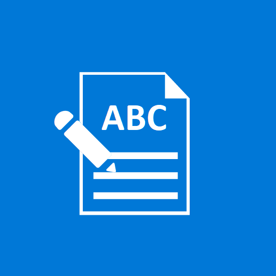
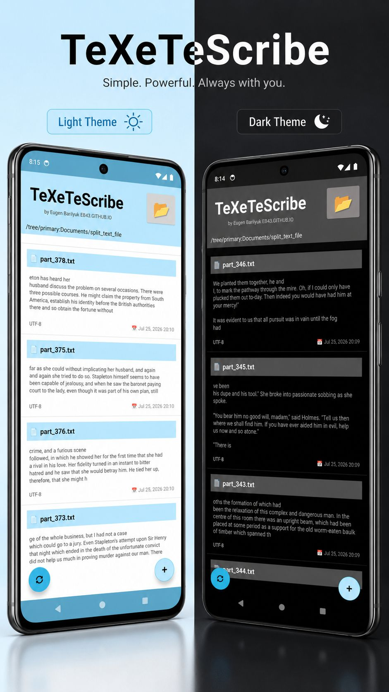
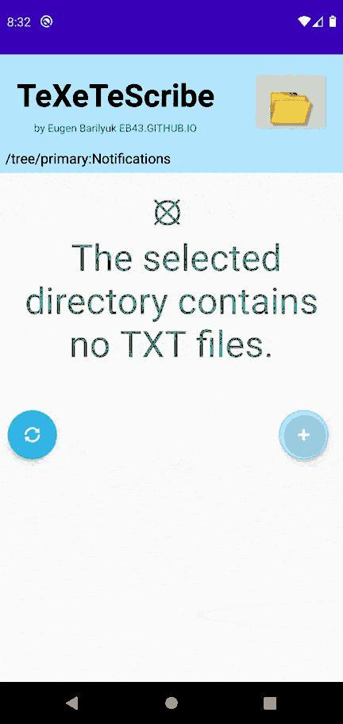
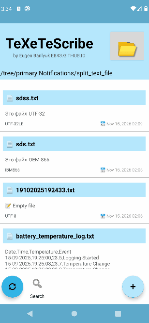
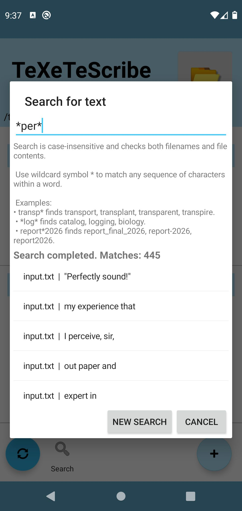
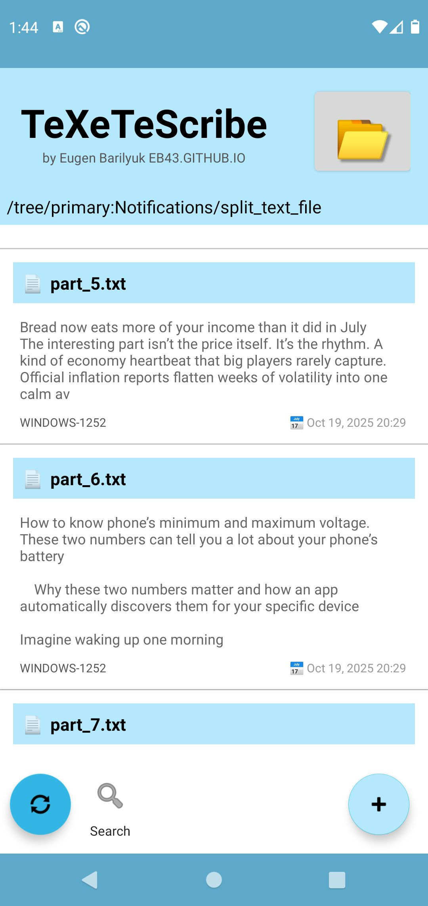
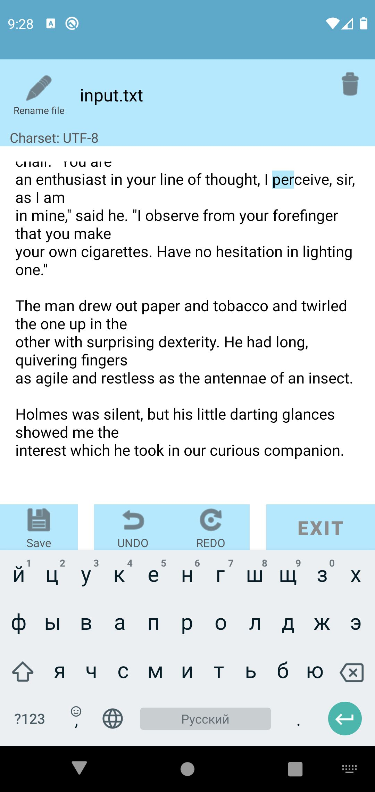
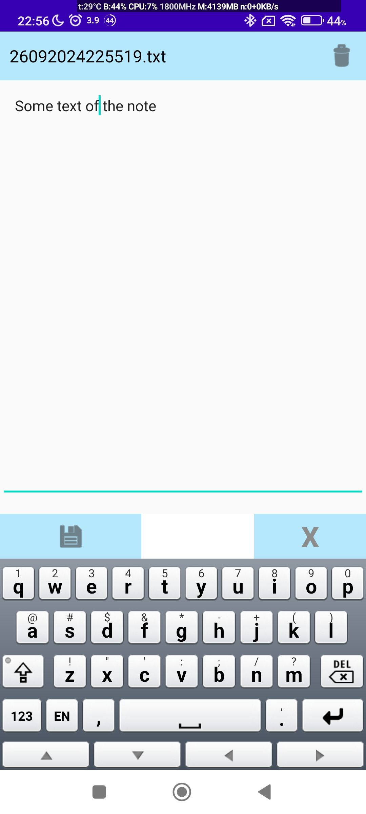
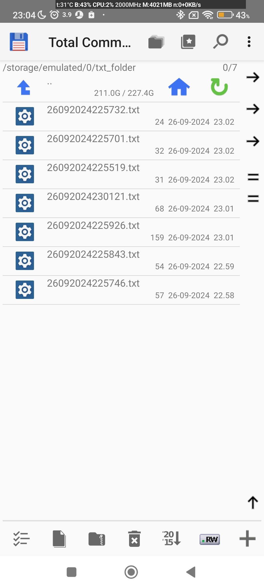

<h1 align="center">📝 TeXeTeScribe</h1>

<b>Offline Android app that saves notes locally as .TXT files - supports external microSD storage</b>

  

    📦 Get TeXeTeScribe installation file: 

  

  
  
or in Releases section of this repository: <a href="https://github.com/Eb43/txtnotes/releases/latest">https://github.com/Eb43/txtnotes/releases/latest</a>

---
### 🗒️ Overview

**TeXeTeScribe** provides what Android still lacks - the ability to read, edit, and create text-based files directly in folders you choose, including on **microSD cards**.  
It is a free, offline note editor designed around plain `.TXT` files for maximum compatibility, privacy, and reliability.

- **App name:** TeXeTeScribe  
- **Minimum Android:** 8.0 (Oreo)  
- **Permissions:** Storage access (read/write to selected folders)  

  
  

    
  

  
  
  

---

### 💡 Why TeXeTeScribe

- **Your data is always readable**. Storing notes in plain `.TXT` format makes them viewable and editable on any device - Android, iOS, Windows, macOS, Linux, ChromeOS, Smart TVs, e-readers, and cloud drives. Every system understands text.  

- **Your notes survive Android failures**. When Android glitches, encrypts, or bricks itself after an update, files in internal storage become unreadable. Saving notes on a microSD card keeps them visible and copyable in any file manager, even if the phone is dead or replaced.  

- **Your text always displays correctly**. The app detects file encoding automatically - whether UTF-8 (Android), ANSI-1251 (Windows), CP-866 (DOS), MacRoman (macOS), or UTF-32. Most Android apps ignore encodings and show gibberish; TeXeTeScribe ensures text looks right.  

- **You find notes instantly**. The folder view shows a preview of each file and its modification time, helping you locate the right note without opening them one by one.  

- **You always return to your latest thoughts**. Files are sorted by last modification time, so your most recent ideas appear on top - exactly how note-taking works in real life.  

- **You stay offline and private**. No cloud sync, no analytics, no background tasks. Everything stays on your device, in your folders.  

- **You control storage**. Create, rename, and manage notes directly inside user-selected folders using Android’s built-in file access system.  

- **You work with any text-based file**. Beyond TXT, it opens and edits MD, LOG, INI, CFG, YAML, JSON, XML, CSV, and more.  
 
- **You own your data**. No accounts, ads, or hidden databases. Every note is a transparent text file you can move, back up, or open anywhere.

  
  

---

### ⚙️ Features

- Save notes as **.TXT** files  
- Choose any folder - including **microSD**  
- Automatic **encoding detection and display**  
- File list with **previews and modification times**  
- Sort by **last modified** date  
- **Auto-save** on exit or minimize  
- **No databases**, just plain text files  
- **Offline and private** operation  
- **Lightweight:** 6.5 MB APK  
- Works on **Android 8.0 and newer**  
- **Open source** and completely free  

---

### 📱 How to Use

1. Tap **➕** to create a new note.  
2. Tap a file to open and edit it.  
3. Tap **Refresh** to reload folder contents.  
4. Tap **X** to close the editor - the note saves automatically.  
5. Use **Select Folder** to switch where your notes are stored.

---

### 🔐 Privacy & Design Philosophy

TeXeTeScribe never leaves your storage.  
No telemetry, no background services, no cloud connections.  
Every note remains a readable `.TXT` file in a location you control.  
What you write stays fully under your ownership.

---

### 🧩 Technical Details

- v1.0. Initial release. Now thoughts and notes on Android can be safely stored on microSD.
- v1.1. Support for “Open with” dialog. Notes can be opened via standard Android dialog
- v1.2. Added UNDO and REDO functionality. Writing polished notes becomes easier.
- v1.3. Added RENAME FILE button. TXT files can be renamed manually as you want in addition to standard auto generated name.
- v1.4. Added UI translation languages Ukrainian and German.
- v1.5. Added Android dark theme support. Fixed selected folder not being remembered in Android 14.
- v1.6. Added text search. Search supports wildcard (*). Search results are clickable for fast travel to the matched word.

---
